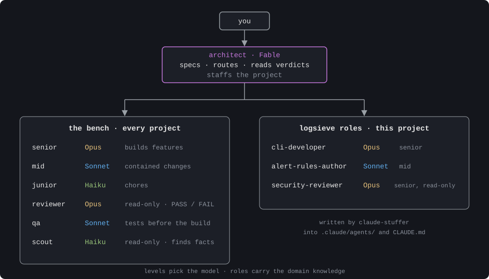
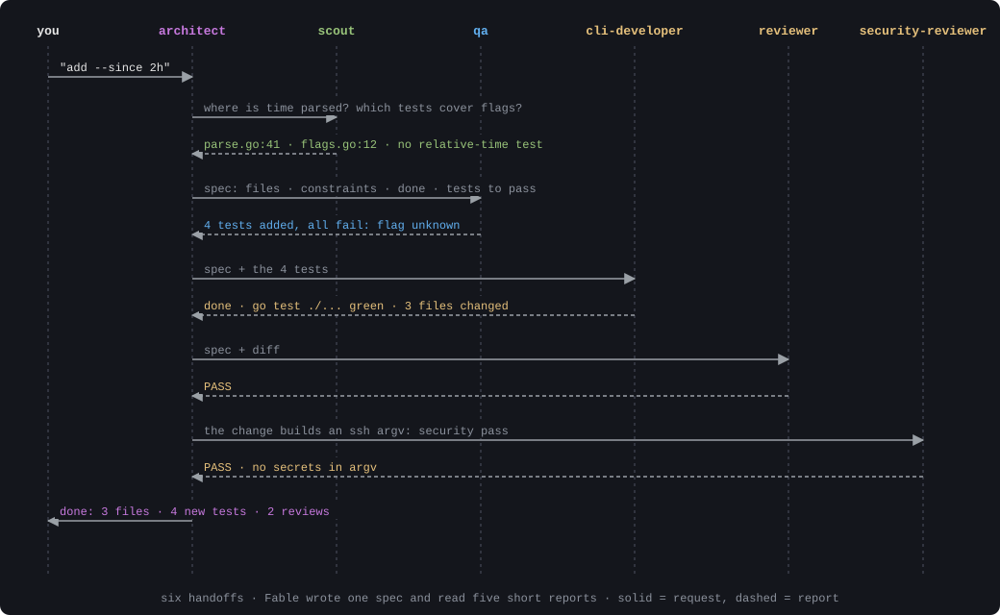
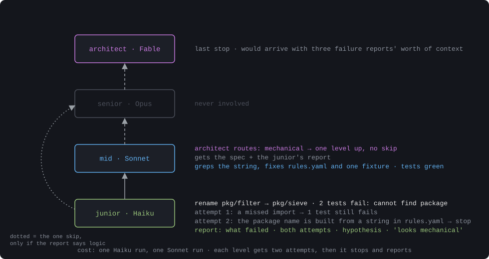

# claude-stuffer

Staff a Claude Code project with a team of subagents, the way an engineering lead staffs a real team: an architect, seniors, mids and juniors, plus a reviewer, a QA engineer and a scout, plus the domain roles this particular project needs.

One Python 3 file, no dependencies. Run it once per machine to install the bench, then once per project to staff it. It asks a few questions, proposes roles, and writes small, readable Markdown files you can edit.

The method is explained in full in the blog post [Your AI Needs an Org Chart](https://lovethepenguin.com/your-ai-needs-an-org-chart/). The short version is below.

## The idea

Claude's models map onto seniority levels. Each costs a different amount and is good at a different size of problem.

| Level | Model | Does |
|-------|-------|------|
| Architect and engineering lead | Fable (the main session) | Talks to you, writes specs, routes work, reads verdicts, decides who is on the team. Does not write code unless escalation reaches it. |
| Senior | Opus | Features, multi-file changes, tricky logic. |
| Mid | Sonnet | Well-defined contained changes, bug fixes with a repro, docs with substance. |
| Junior | Haiku | Renames, formatting, moving files, git housekeeping, running a command. |

Four roles sit beside the ladder:

| Role | Level | Does |
|------|-------|------|
| `reviewer` | Senior, no code edits | Checks a finished change against its spec and tests. PASS or FAIL with reasons. Writes only `review.md`. |
| `qa` | Mid | Writes the tests from the spec before anyone builds. |
| `scout` | Junior, no code edits | Answers the architect's questions about the codebase with file paths and line numbers. Writes only `scout.md` and `FACTS.md`. |
| `pm` | Mid | Keeps the backlog and the ticket log, grooms items until ticket-ready, writes status. No code, no priorities. |

Rules the architect follows, installed by `init`:

- Route each task to the most junior level that can do it reliably, with a complete spec: files, constraints, what "done" means, which tests must pass.
- No tests in the project: code goes to the senior and the spec says how to verify.
- **Escalation.** The author of the code gets the first look at a failure, two attempts. Then the architect hands the spec plus the failure report one level up: junior, mid, senior, architect. Never skip a level, except when the junior's report says the failure is in logic, not mechanics. Never resend to the same level.
- **Staffing.** A role is a prompt with domain knowledge, not a level. A role exists only if the backlog has tasks for it. Project roles live in the project, the bench lives in `~/.claude`.

## What writes where

| Command | Writes to | Scope |
|---|---|---|
| `claude-stuffer init` | `~/.claude/agents/` (the seven bench files) and a marked block in `~/.claude/CLAUDE.md` | global, once per machine |
| `claude-stuffer` | `<project>/.claude/agents/` and a marked block in `<project>/CLAUDE.md` | that folder only |
| `claude-stuffer ticket <slug>` | `<project>/docs/tickets/` | that folder only |
| `claude-stuffer show` | nothing | reads that folder |

The per-project commands never touch `~/.claude`, and `init` never touches a project. Skipping `init` still works: the project command only warns that the bench is missing.

## Install

You need Python 3.9 or newer. On macOS, if `python3 --version` prompts you to install developer tools, run `xcode-select --install` once.

```bash
curl -fsSL https://raw.githubusercontent.com/kpatr1981/claude-stuffer/main/claude-stuffer -o /tmp/claude-stuffer
sudo install -m 0755 /tmp/claude-stuffer /usr/local/bin/claude-stuffer
claude-stuffer init
```

This works the same on macOS and Linux. `/usr/local/bin` is owned by root, so the copy needs `sudo`.

Without sudo, with Homebrew installed, put it in Homebrew's bin directory, which is already on your PATH:

```bash
curl -fsSL https://raw.githubusercontent.com/kpatr1981/claude-stuffer/main/claude-stuffer -o /tmp/claude-stuffer
install -m 0755 /tmp/claude-stuffer "$(brew --prefix)/bin/claude-stuffer"
```

Or use `~/.local/bin`, which is not on the default macOS zsh PATH. Add it to `~/.zshrc` and open a new shell:

```bash
mkdir -p ~/.local/bin
curl -fsSL https://raw.githubusercontent.com/kpatr1981/claude-stuffer/main/claude-stuffer -o /tmp/claude-stuffer
install -m 0755 /tmp/claude-stuffer ~/.local/bin/claude-stuffer
echo 'export PATH="$HOME/.local/bin:$PATH"' >> ~/.zshrc
```

Then run `claude-stuffer init`.

`init` writes the seven bench agents to `~/.claude/agents/` and the routing rule into `~/.claude/CLAUDE.md`, inside a marked block so it can be updated later. Existing files are kept unless you pass `--force`. Set Fable as the default model with `"model": "claude-fable-5-1"` in `~/.claude/settings.json`, or `/model claude-fable-5-1` in a session.

## Staff a project

```bash
cd ~/code/my-project
claude-stuffer
```

The tool looks at the folder first and uses what it finds as defaults: languages and frameworks from marker files, the test command, the kind of project, the documents a role should read first, and whether it looks like it touches production. Then it asks:

1. Project name and a one-line description.
2. Kind: cli, service, web, mobile, game, data, infra, library, content, other.
3. Languages, test command, production yes or no, documents to read first.
4. For each role the kind proposes: keep it or drop it.
5. Add-ons: `site-ops` when production is involved, `security-reviewer` (no code edits) when production, auth, tokens, ssh or cloud APIs are mentioned.
6. Custom roles: a name, what it does, what it must know, and a level.
7. The list of files it will write, and one confirmation.

It writes one file per role under `.claude/agents/` and a `## Team` block in the project's `CLAUDE.md`. Each role file carries the project description, the documents to read first, the stack, the test command, the role's rules, and the same two-attempt failure protocol as the bench. Read-only roles (`security-reviewer`) get a restricted tool list and never modify a file.

Other commands:

```bash
claude-stuffer ticket add-since-flag  # handoff folder docs/tickets/add-since-flag/ with the spec template
claude-stuffer show                 # the project's current team
claude-stuffer --kinds              # kinds and the roles each proposes
claude-stuffer --dry-run            # print what would be written, write nothing
claude-stuffer --answers team.json  # non-interactive, for scripts and tests
claude-stuffer --force              # overwrite files this tool generated earlier
```

Re-running in the same folder is how you revisit the team. Generated files you have edited are kept unless you pass `--force`. Files you wrote by hand are never touched. Nothing is ever deleted; the tool tells you which generated files are no longer part of the team.

## Handoffs through files

Subagents share the working tree, so context passes through files, not chat. `claude-stuffer ticket <slug>` creates `docs/tickets/<slug>/spec.md` with the four parts of a spec, plus What and Notes, as headings, plus `docs/tickets/LOG.md` (one line per finished ticket) and `docs/tickets/FACTS.md` (durable facts the scout appends) if they are missing. Each agent writes its report to the ticket folder (`scout.md`, `tests.md`, `build.md`, `review.md`) and replies in chat with one line: verdict and path. The bench prompts installed by `init` already say so.

Also in the rule: a builder that needs a file the spec does not list stops instead of widening the change; several junior chores in one project go into one ticket; the `pm` role keeps `PENDING.md` and `LOG.md` so the architect does not.

## Example: logsieve

A small Go tool that tails logs from several hosts over SSH, filters them with rules and raises alerts. It has tests and it talks to production boxes.

```
$ cd ~/code/logsieve && claude-stuffer
claude-stuffer 0.2.0: staffing a project. Enter accepts the default in brackets.

Project name [logsieve]:
What is it, in one line [Tails and filters logs from several hosts over SSH.]:
Kinds:
   1. cli      cli-developer
   2. service  backend-developer, db-engineer
   3. web      frontend-developer, backend-developer, ui-designer
   4. mobile   app-developer, ui-designer
   5. game     game-designer, gameplay-programmer, artist
   6. data     data-engineer, analyst
   7. infra    site-ops
   8. library  library-developer, docs-writer
   9. content  tech-writer, editor
  10. other    (custom roles only)
Kind [infra]: cli
Languages/frameworks, comma separated [Go, Shell]:
Test command ("none" if there is no test suite) [go test ./...]:
Touches production systems (servers, cron, live databases)? [Y/n] y
Documents a role must read first, comma separated [README.md, docs/design.md]:
Keep cli-developer (senior): Builds the command-line tool: flags, help text, exit codes and the non-interactive mode? [Y/n] y
Add site-ops (mid): Runs and changes servers and deployments (use senior for production changes)? [y/N] n
Add security-reviewer (senior): Reviews changes for leaked secrets, trust boundaries, dependency fetching and credential permissions; no code edits? [y/N] y
Custom roles (blank name to finish).
  Role name (lowercase, hyphens): alert-rules-author
  What it does (one line): writes alert rules and their fixtures from real log samples
  What it must know (comma-separated paths or notes): docs/rules.md, samples/
  Level (senior, mid, junior) [mid]:
  Role name (lowercase, hyphens):

Files for logsieve (cli-developer, security-reviewer, alert-rules-author):
  would write  .claude/agents/cli-developer.md
  would write  .claude/agents/security-reviewer.md
  would write  .claude/agents/alert-rules-author.md
  would update CLAUDE.md
Write these files? [Y/n]
Staffed logsieve:
  wrote        .claude/agents/cli-developer.md
  wrote        .claude/agents/security-reviewer.md
  wrote        .claude/agents/alert-rules-author.md
  updated      CLAUDE.md
Check with /agents in a new session.
```

Notice the kind: the folder has an `ops/` directory, so the tool guessed `infra`, and I corrected it to `cli`. Detection gives defaults, it does not decide. The block it added to the project's `CLAUDE.md` is what the architect reads at the start of every session:

```markdown
## Team (staffed 2026-10-10 by claude-stuffer)

Global bench applies (`senior`, `mid`, `junior`, `reviewer`, `qa`, `scout`, `pm`). Project roles, level chosen per task by the architect:

- `cli-developer` (Opus; senior): Builds the command-line tool: flags, help text, exit codes and the non-interactive mode.
- `security-reviewer` (Opus; senior): Reviews changes for leaked secrets, trust boundaries, dependency fetching and credential permissions; no code edits.
- `alert-rules-author` (Sonnet; mid): Writes alert rules and their fixtures from real log samples.
- Production: changes are specified, backed up and verified one at a time; the user applies anything the spec marks as manual.
```

The team:



One feature, `--since 2h`, from request to done:



A chore that goes wrong, and climbs the ladder:



## Undo

Delete the files it told you it wrote: the role files under `<project>/.claude/agents/` and the block between `<!-- claude-stuffer:team -->` and `<!-- /claude-stuffer:team -->` in the project's `CLAUDE.md`. For `init`, the seven bench files in `~/.claude/agents/` and the block between `<!-- claude-stuffer:rules -->` and `<!-- /claude-stuffer:rules -->` in `~/.claude/CLAUDE.md`.

## Development

```bash
python3 -m unittest discover -s tests -v
```

Spec: `docs/spec.md`. Pull requests welcome; keep it one file and stdlib only.

## License

MIT. Copyright (c) 2026 Konstantinos Patronas.
